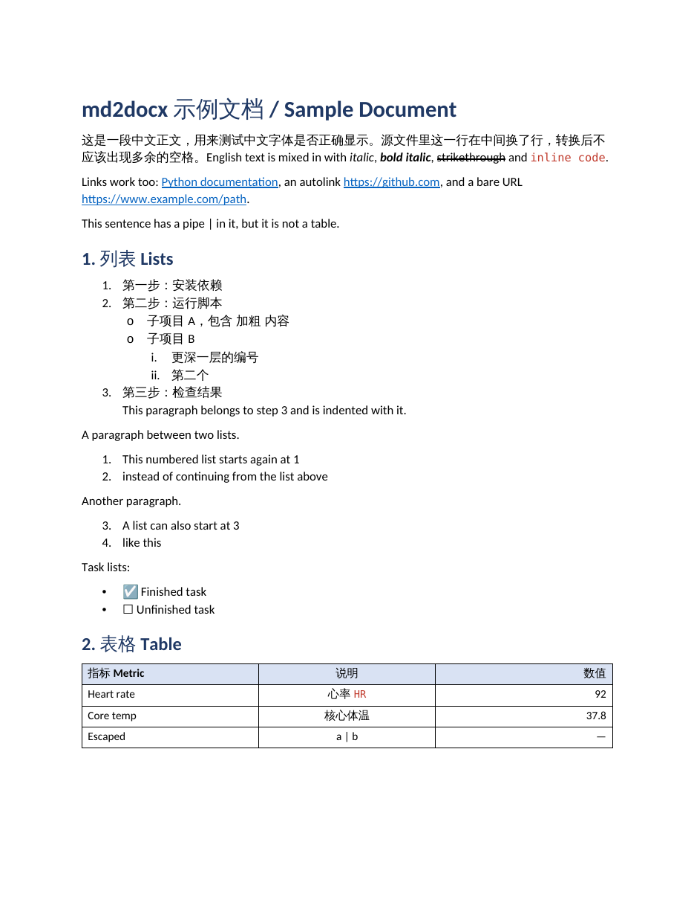

# md2docx

**English** | [简体中文](README.zh-CN.md)

Convert Markdown (`.md`) files to Word (`.docx`), with support for Chinese text, headings, tables, lists, links and local images.

Once set up, each conversion is: **type the Python command → drag in the script → drag in your Markdown file → press Return.**

**Use `python3` on Mac and `python` on Windows.** Follow the instructions for your system below.

## Quick start (Mac)

### 1. Download

Click **Code → Download ZIP** above, extract the ZIP, and find **`md2docx.py`**.

### 2. Set up once

If Python is not installed, download the macOS installer from [Python.org](https://www.python.org/downloads/macos/) and follow its installation steps.

Press **⌘ + Space**, search for **Terminal**, and open it. Paste this line, press Return, and wait for installation to finish:

```bash
python3 -m pip install "python-docx>=1.0"
```

This installs the conversion component. You only need to do it once for this Python installation.

### 3. Convert a file

In Terminal:

1. Type **`python3`** followed by a **space**.
2. Drag **`md2docx.py`** from Finder into the Terminal window to fill in its path.
3. Make sure there is a **space** after that path, then drag in your **`.md` file**.
4. Press **Return**.

When Terminal shows `Converted:`, look **in the folder containing your Markdown file** for a Word file with the same name: `notes.md` becomes `notes.docx`.

An existing Word file with that name is overwritten. Rename it first if you want to keep the previous version.

<details>
<summary>Windows instructions</summary>

1. Download and extract the tool, and install Python from [Python.org](https://www.python.org/downloads/windows/). If the installer offers **Add Python to PATH**, select it.
2. Open Command Prompt and run this once:

```bat
python -m pip install "python-docx>=1.0"
```

3. Copy **`md2docx.py` into the folder containing your Markdown file**, keeping the Markdown file and its images in their original locations.
4. In File Explorer, open that folder, type `cmd` in the address bar, and press Enter.
5. Run the following, replacing `notes.md` with your actual file name and keeping the double quotes:

```bat
python md2docx.py "notes.md"
```

The Word file appears in the same folder.

</details>

## Preview



[Example Markdown](examples/sample.md) · [Example Word document](examples/sample.docx)

<details>
<summary>Troubleshooting</summary>

- **`python3` / `python` not found:** install Python, close Terminal or Command Prompt, then reopen it. If the problem remains, open an [issue](https://github.com/izeeternal9911/md2docx/issues) with the error message and your operating system.
- **`No module named 'docx'`:** run the component installation command under “Set up once” again and check that it completes successfully.
- **`file not found` / `can't open file`:** drag both files into Terminal again on Mac. On Windows, check that the script was copied into the Markdown folder and that you used the actual file name. Manually entered paths containing spaces need double quotes.
- **Different fonts:** the viewing computer needs the selected fonts installed; Word may substitute missing fonts.

</details>

<details>
<summary>Supported formatting</summary>

- Headings H1–H6 (ATX `#` and Setext `===`)
- **Bold**, *italic*, ***bold italic***, ~~strikethrough~~, `inline code`, escapes (`\*`)
- Links, autolinks `<https://…>` and bare URLs → clickable Word hyperlinks
- Bullet, numbered and **nested** lists as real Word numbering
  - numbering restarts for each new list and respects the start number (`3.`)
  - mixed bullet/numbered nesting, task lists `- [x]`
  - continuation paragraphs and fenced code **inside** list items
- Tables with header shading, column alignment (`:--`, `:-:`, `--:`), escaped pipes `\|`, `<br>` in cells, header row repeated across pages
- Fenced code blocks (```` ``` ```` and `~~~`) with preserved indentation
- Block quotes, including GitHub alerts (`> [!NOTE]`, `> [!WARNING]`, …)
- Local images (PNG/JPG/GIF/BMP/TIFF), scaled to page width, alt text as caption
- Horizontal rules (or page breaks with `--hr-pagebreak`)
- Optional table of contents (`--toc`)
- Use your own `.docx` as a style template (`--template`)
- YAML front matter and HTML comments are skipped
- Batch conversion with wildcards (also on Windows)

</details>

<details>
<summary>More options: fonts, table of contents, templates and batch conversion</summary>

These examples assume Terminal is open in the folder containing `md2docx.py` and your input files. On Windows, replace `python3` with `python`.

```bash
python3 md2docx.py "notes.md"
python3 md2docx.py "notes.md" -o "final.docx"
python3 md2docx.py "notes.md" --cjk-font 宋体
python3 md2docx.py "notes.md" --toc
python3 md2docx.py "notes.md" --template "journal template.docx"
python3 md2docx.py "*.md"
```

| Option | Default | Description |
|---|---|---|
| `-o, --output` | `<input>.docx` | Output path (single input only) |
| `--font` | `Calibri` | Font for Latin text |
| `--cjk-font` | `等线` (DengXian) | Font for Chinese/Japanese text, e.g. `宋体`, `微软雅黑`, `仿宋` |
| `--code-font` | `Consolas` | Font for code |
| `--font-size` | `11` | Body size in pt; headings scale with it (without `--template`) |
| `--toc` | off | Insert a table of contents at the top |
| `--toc-title` | `Contents` | Heading for the table of contents |
| `--hr-pagebreak` | off | Treat `---` as a page break instead of a line |
| `--template` | none | Take styles (fonts, headings, margins) from an existing `.docx` |

**Fonts:** the computer used to view the document must have the selected fonts installed. md2docx does not install or embed fonts; Word may substitute missing fonts.

**Table of contents:** includes headings H1–H3. Open the document in Microsoft Word and accept any prompt to update fields. If the TOC does not refresh automatically, right-click it and choose *Update Field*. Support in other editors varies.

**Templates:** the template's body content is cleared. Its styles, final section's page setup, and associated headers and footers are retained. Body and heading fonts are inherited unless you pass `--font` / `--cjk-font`. Code uses `--code-font` (default: `Consolas`).

### Placeholder lines

A line consisting only of `[**…**]` becomes a centred, grey italic placeholder — handy for marking where figures will go in a draft:

```markdown
[**Figure 2: Conceptual framework (to be inserted)**]
```

</details>

<details>
<summary>Known limitations</summary>

- Math / LaTeX (`$…$`) — left as plain text. Use Pandoc for math-heavy documents.
- Footnotes, definition lists, raw HTML (other than `<br>`)
- Indented (4-space) code blocks — use fenced blocks
- Tables or quotes nested *inside* list items; nested quotes are flattened
- Remote images (shown as a link instead of being downloaded)

</details>

<details>
<summary>For developers: project installation, Python API and tests</summary>

Requires Python 3.8+. These project installation and development options are optional. On Windows, replace `python3` in all commands below with `python`.

### Install the md2docx command

With Git installed:

```bash
python3 -m pip install git+https://github.com/izeeternal9911/md2docx.git
```

Or, from the extracted folder containing `pyproject.toml`:

```bash
python3 -m pip install .
```

Then use `md2docx "notes.md"` with the same options as the script. On Windows, replace `python3` in the installation commands with `python`.

### Python API

```python
from md2docx import md_to_docx, convert, Options

md_to_docx("report.md", "report.docx", toc=True, cjk_font="宋体")

doc = convert("# Title\n\n你好，世界", Options(font_size=12))  # python-docx Document
doc.save("hello.docx")
```

### Run tests

From the project folder:

```bash
python3 -m pip install "python-docx>=1.0" pytest
python3 -m pytest
```

</details>

Feedback is welcome in [Issues](https://github.com/izeeternal9911/md2docx/issues).

License: [MIT](LICENSE).
